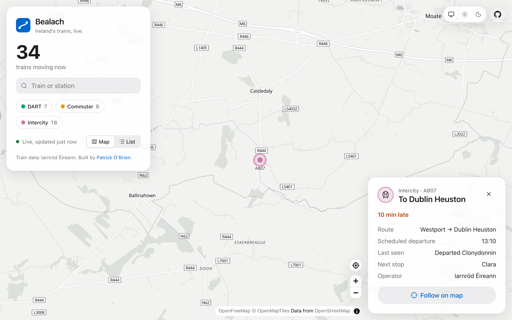

# Bealach

**Ireland's trains and buses, live on a map.**

Bealach (Irish for "way" or "route", said *BAL-ukh*) shows every Irish Rail,
DART and commuter train moving right now, with how late it's running, where it
was last seen and its next stop. Add a free NTA key and Dublin Bus, Bus
Éireann, Go-Ahead and Luas appear too.

[](docs/screenshot.png)

[](https://vercel.com/new/clone?repository-url=https%3A%2F%2Fgithub.com%2Fobrienafc%2Fbealach&project-name=bealach&env=NTA_API_KEY&envDescription=Optional%3A%20free%20key%20from%20developer.nationaltransport.ie%20for%20buses%20and%20Luas&envLink=https%3A%2F%2Fdeveloper.nationaltransport.ie)

## Features

- **Live positions** refreshed every 20 seconds, gliding from one report to
  the next so you can see which train went where.
- **Delays at a glance.** Each train shows minutes late or early, its last
  station and next stop. The list view sorts the most delayed first.
- **Search** by train code, route number or station: "Cork", "E868", "46A".
- **Follow a train** to keep it centred as it moves, and share a link straight
  to it (`?v=train:A807`).
- **Light, dark or system appearance**, with a matching map.
- **Every state handled:** loading, no trains overnight, a delayed feed, and
  the feed being down, with the last good positions kept on screen.
- **Accessible:** the list view gives a text alternative to the map, mode
  colours are colour-blind safe and always paired with a label, and gliding
  turns off with reduced motion.

## Data

| Layer | Source | Key |
| ----- | ------ | --- |
| Trains (DART, Commuter, Intercity) | [Irish Rail realtime API](https://api.irishrail.ie/realtime/) | None |
| Buses and Luas | [NTA GTFS-Realtime](https://developer.nationaltransport.ie) | Free, set `NTA_API_KEY` |
| Route names and destinations | NTA GTFS timetable, read at build time | None |
| Map | [OpenFreeMap](https://openfreemap.org), © OpenMapTiles, © OpenStreetMap contributors | None |

Irish Rail reports where each train last checked in, usually a station, rather
than GPS. Trains therefore move in hops between stations, and Bealach glides
them along so the motion is easy to follow.

## How it works

- **`/api/trains`** and **`/api/buses`** fetch the upstream feeds and return a
  compact list of vehicles. Responses are cached on the CDN for 15–20 seconds,
  so every visitor shares one upstream request. A slow or failed upstream
  serves the last copy instead of blocking.
- **Route names** come from the national GTFS timetable, a 150 MB zip.
  `scripts/update-routes.mjs` reads only `agency.txt`, `routes.txt` and
  `trips.txt` from it with HTTP range requests (about 3 MB) before each build.
  If that fails, the committed snapshot in `data/routes.json` is used.
- **The map** is [MapLibre GL](https://maplibre.org). Its page code and web
  worker must be the exact same build, so both are served unbundled from
  `public/maplibre/<version>/` (copied on install by
  `scripts/copy-maplibre.mjs`).

## Run it

```bash
npm install
npm run dev
```

Buses and Luas need an NTA key: register at
[developer.nationaltransport.ie](https://developer.nationaltransport.ie),
subscribe to the GTFS-R API, and set it as `NTA_API_KEY` (in `.env.local`, or
in your host's environment variables). No rebuild is needed; buses appear on
the next page load. Node 20+.

## License

[AGPL-3.0](LICENSE). You can use, modify and self-host Bealach freely. If you
run a modified version as a public service, you must share its source code
under the same licence.

Sister projects: [Glyphyard](https://github.com/obrienafc/glyphyard) (self-hosted
Google Fonts) and [Spillcheck](https://github.com/obrienafc/spillcheck) (see
every third party a website talks to).
